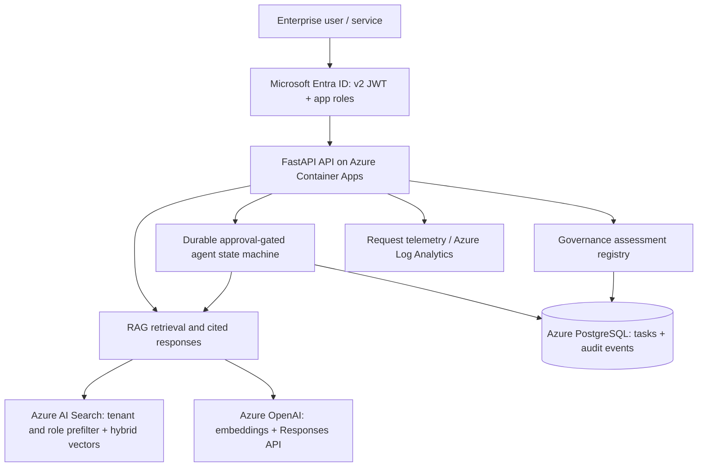

# Enterprise AI Architecture — Engineering Release 1.0

**Three connected systems:** Azure knowledge assistant, durable approval-controlled agent platform, and AI governance registry.

**Maturity:** Deployable application source and test harness; **not** a verified live Azure deployment, production service or independently assessed certification. The public browser demonstrations at https://iadam0123.github.io/projects/ remain synthetic reference prototypes.

## System architecture



## Architecture evidence

- **Identity:** Every business endpoint requires valid Entra v2 JWT with issuer, audience, expiration, tenant, and signing-key validation. A role claim is required per operation.
- **Retrieval security:** Search filters on the token tenant and permitted app role *before* documents reach the model; citations are returned only for authorized retrieved passages.
- **Real model integration:** Uses Azure OpenAI v1 Responses API with managed identity, and embeddings for vector and lexical hybrid search. Actual generated responses require deployed Azure models.
- **Agent durability:** PostgreSQL-backed state transitions, separate requester/reviewer, row locking, replay prohibition, audit-event persistence. Tool allowlist is deliberately non-destructive: procurement review does **not** execute a payment.
- **Governance:** Risk decisions and controls are stored by tenant; the score is an illustrative triage heuristic, **not** an ISO/NIST certification.
- **Observability:** Prometheus metrics in code and FastAPI OpenTelemetry instrumentation; production dashboards/exporter, alerts, and traces require additional configuration.
- **CI:** GitHub Actions runs Python tests and container build on changes.
- **Infrastructure:** Bicep skeleton provisions Container Apps + Log Analytics, referencing Azure resources that must already be established.

## Run tests locally
```bash
cd engineering
python -m venv .venv
source .venv/bin/activate
pip install -r requirements.txt
RUN_SCHEMA_CREATE=false pytest tests -q
```
On Windows PowerShell, activate with `.venv\Scripts\Activate.ps1`.

## Run API locally

Copy `.env.example` to a private `.env`, provision Azure resources and Entra app registration, then set the environment variables in your shell and run:

```bash
cd engineering
uvicorn app.main:app --reload --port 8080
```

Open http://localhost:8080/docs for interactive OpenAPI docs. Business requests require an Entra bearer token with relevant app roles. No anonymous production endpoints are intentionally exposed beyond health checks.

## Seed an Azure AI Search index

With Azure identity configured and permissions delegated:
```bash
cd engineering
python -m scripts.seed_search
```
This seeds four **synthetic** demonstration documents. Set `AZURE_EMBEDDING_DIMENSIONS` to the exact embedding model output dimension; otherwise ingestion fails safely.

## Evaluate a real deployed endpoint
```bash
TEST_API_BASE_URL=https://<your-api-host> TEST_ENTRA_TOKEN=<short-lived-token> python evaluation/eval_rag.py
```
The evaluation checks citation presence and expected terms. It is a reproducible **smoke benchmark**, not a validated factuality, faithfulness or security benchmark. Add human-labeled relevance, retrieval recall, refusal, prompt injection, privacy, concurrency and latency evaluation before production.

## Production delivery prerequisites

1. Authorize an Azure subscription and budgets, select regions and model deployments, create resource group, managed search, OpenAI, managed PostgreSQL, container registry and Key Vault.
2. Configure Entra API application roles and client sign-in/consent. Assign app managed identity only needed RBAC roles; restrict network access and enforce TLS.
3. Apply reviewed DB migrations with `cd engineering && alembic upgrade head` in an authorized deployment/migration job before setting production `RUN_SCHEMA_CREATE=false`. Never enable automatic schema creation in production.
4. Build/push image; grant Container Apps pull authorization to ACR; deploy Bicep using GitHub Actions OIDC environment approvals.
5. Run the integration benchmark and security tests against the **actual** deployed services; configure OpenTelemetry exporters, alarms, request limits, backup and restore.
6. Have an independent reviewer inspect threat model, tests, cloud deployment and evidence.

The Bicep infrastructure template is intentionally an adoption starter, not an unattended full-stack production deployment: existing OpenAI, AI Search, PostgreSQL, ACR, RBAC and networking remain prerequisites. Do not claim that a public GitHub Pages static demonstration proves these backend capabilities are live.

## Official technical references
- [Azure OpenAI managed-identity security and deployment](https://learn.microsoft.com/en-us/azure/developer/ai/get-started-securing-your-ai-app)
- [Azure OpenAI v1 Responses migration](https://learn.microsoft.com/en-us/azure/developer/ai/how-to/azure-openai-to-responses)
- [Azure AI Search hybrid retrieval](https://learn.microsoft.com/en-us/azure/search/hybrid-search-how-to-query)
- [Microsoft Entra access tokens](https://learn.microsoft.com/en-us/entra/identity-platform/access-tokens)
- [NIST AI Risk Management Framework](https://www.nist.gov/itl/ai-risk-management-framework)
